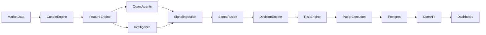

# Architecture

The system is a paper-trading pipeline. Live order placement is hard-coded off.

Contracts in `packages/contracts` define the wire schema (`schema_version` `1.0`), order types, horizons, and trading modes. Services import that package. They do not redefine it.

Market data becomes candles. The feature engine builds a `FeatureSet` at version `1.1.0`. Five quant agents and the intelligence service publish signals. Ingestion keeps a signal when its timestamp is at or before `as_of` and `valid_until` is at or after `as_of`. Fusion weights the selected signals and clips the aggregate to `[-1, 1]`. The decision engine builds one proposal. The proposal id is the SHA-256 of symbol, horizon, `as_of`, strategy id `paper-fusion`, and strategy version `1.0.0`. A stored decision for that key is final.

Risk accepts `PAPER` only. It rejects `BACKTEST`, `SHADOW`, and `LIVE` inside `assess()`. It rejects shorts. A buy must fit available cash and a 100,000 notional cap. Stop and target on a proposal are 2% and 4%.

Paper execution and backtest share one path. A market decision on candle `t` fills at the next stored open. No later bar means the order stays unfilled. Quantity is the largest whole share under cash and the notional cap. The default cost is 2 bp unless the caller passes an explicit schedule, including an explicit 0. If stop and target are both inside one later bar, the stop wins. Fills, positions, cash, and orders are stored through `CoreRepository`.

The API on port 8000 reads that store. The Next.js dashboard on port 3000 calls `/api/v1/*`. `live_enabled` in the API responses is false. The UI does not enable live trading.

Quant default research mode is swing on daily bars. `MlAgent` is not loaded. The five rule agents are the ones that vote.
