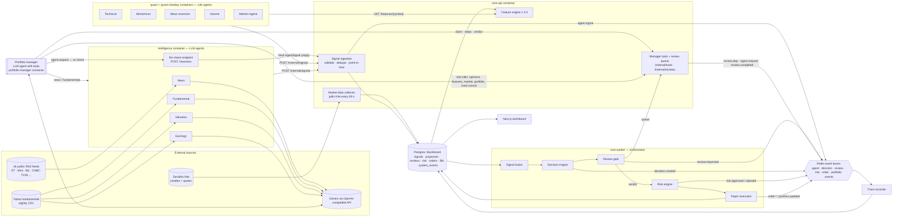

# Design document

## (a) Architecture: every agent and how they communicate

Communication channels:

| From → to | Mechanism | Message |
|---|---|---|
| Kite → collector | HTTPS (kiteconnect) | 5-minute and daily candles |
| Quant agents → Core | `GET /api/v1/features/{symbol}` | `FeatureSet` (only bars with `end ≤ as_of`) |
| RSS → News agent | HTTPS poll, `defusedxml`, size/item caps | `NewsArticle` mapped to NIFTY symbols |
| Intelligence agents ↔ LLM | OpenAI-compatible chat completions, JSON answer, schema-validated | sentiment, impact, confidence, reason codes |
| Every specialist → Core | `POST /api/v1/internal/signals` (internal token) | `AgentSignal` |
| Ingestion → bus | Redis `agent.events` | `agent.signal` |
| Decision engine → manager | review queue in Postgres + Redis `review.events` | `ReviewRequest` (`review.requested`) |
| Manager ↔ Core tools | `GET /api/v1/internal/tools/{opinions,features,market,portfolio,track_record}` | read-only views of the blackboard |
| Manager → Core | `POST /internal/reviews/{id}/steps`, `/verdict` | `ReviewStep` (`review.step`), `ProposalReview` (`review.completed`) |
| Manager → intelligence agent | `agent.request` on `agent.events`, delivered by `POST /reassess` | `AgentRequest`; the reply is a new `AgentSignal` tagged with the `request_id` |
| Orchestrator stages → bus | Redis `decision/risk/order/portfolio.events` | `TradeProposal`, `RiskDecision`, `Order`, `Execution`, `Position` |
| Bus → trace recorder | Redis `psubscribe *.events` | stored once per `event_id` in `system_events` |

One schema package, `packages/contracts` (1.1.0), defines every message, and all services import it. Every envelope carries a `correlation_id`. For a real trade it is the proposal id, so one chain links the agent opinions → proposal → **manager review (every step)** → risk decision → order → fill. An operator's question to the manager is its own chain.

## (b) Agents: roles and responsibilities

| Agent | Kind | Input | Responsibility |
|---|---|---|---|
| Technical | Rules (1.4.0) | RSI, MACD gap, EMA/SMA trend, ATR-scaled distance to SMA20 and VWAP | trend / overbought view |
| Momentum | Rules (1.4.0) | ROC-10 z-score, ADX, relative strength vs NIFTY | momentum view |
| Mean reversion | Rules (1.4.0) | 20-bar z-score, Bollinger %B, ADX (stands aside in strong trends) | over-extension view |
| Volume | Rules (1.4.0) | relative volume, volume acceleration, price-volume correlation | participation view |
| Market regime | Rules (1.4.0) | NIFTY EMA trend, India VIX change, volatility percentile | risk-off flag (a filter, not a vote) |
| News | **LLM** (1.1.0) | live RSS headlines from the last 72 h | sentiment × impact, event type, headlines |
| Fundamental | **LLM** (1.1.0) | Yahoo fundamentals, percentile-ranked across the 50 | company health |
| Valuation | **LLM** (1.1.0) | P/E vs history and peers | cheap / expensive |
| Earnings | **LLM** (1.1.0) | latest results vs prior periods | earnings surprise |
| **Portfolio manager** | **LLM + tools** (1.0.0) | a proposed BUY, plus anything its tools return | plans, gathers evidence, resolves conflicts, asks agents to re-check, then approves, shrinks or vetoes |
| ML | model, **not loaded** | research features | off: no model passed its pre-registered gate |
| Signal ingestion | code | `AgentSignal` | rejects unknown, future-dated, duplicate or wrong-mode signals |
| Signal fusion | code | newest valid opinion per agent | confidence-weighted average with per-agent reliability weights |
| Decision engine | code | fused signal + latest bar | `TradeProposal` when \|signal\| ≥ 0.2 and confidence ≥ 0.3 |
| Review gate | code | proposal + manager verdict | waits up to 240 s; applies REDUCE; records UNAVAILABLE on timeout |
| Risk engine | code (1.3.0) | proposal, book, market, supporting opinions, verdict | 6 order checks; for BUYs 5 portfolio checks (positions, sector, exposure, per stock, entries/day), 7 trade checks (daily loss limit, drawdown limit, loss at the stop per trade, reward-to-risk, price drift since the signal, stop-out cooldown, evidence quality: no buy resting only on fallback heuristics), intraday market regime, and the `portfolio_manager` verdict. Every limit is a bounded Setting. |
| Strategy (Strategy lab) | code, optional | a user-built rule algorithm applied to paper | per Settings `strategy_mode`: **replace** the agents' entries, trade **alongside** them, or trade only when the **agents agree** (fused view not bearish, then a portfolio-manager review) |
| Paper execution | code | approved proposal | CNC limit order at next bar, Zerodha charges, 6 entries/day, 09:20–10:30 IST entry window, kill switch |
| Trace recorder | code | every bus | append-only record of every handoff |

Fusion weights come from the agent backtest (`services/quant/docs/agent-tuning-result.md`). On the swing book only News carries weight (0.5). Every quant agent's swing weight is 0, because none kept a validated edge. Fundamental, valuation, earnings and ML have weight 0 (`FUSION_EXCLUDED_AGENTS`). They still run, and the portfolio manager reads their arguments, so they inform the review without voting.

### Which parts are agentic

| Part | Plans | Reasons with an LLM | Uses tools | Memory | Adapts / replans | Talks to other agents |
|---|---|---|---|---|---|---|
| **Portfolio manager** | yes: states a plan, then picks tools by what it finds | yes | 8 tools | its past reviews and their outcomes (`get_track_record`) | yes: see below | asks News/Fundamental/Valuation/Earnings to re-check |
| News, Fundamental, Valuation, Earnings | — | yes | data providers | answer cache | fall back to a labelled heuristic when the LLM fails | answer re-check requests |
| Quant agents | — | no: deterministic rules | feature engine | — | — | publish opinions |
| Fusion, decision, risk, execution | — | no: code | — | — | — | — |

The split is deliberate: *agents give opinions; code makes the decisions.* LLMs are good at weighing conflicting, unstructured evidence and bad at being trusted with money. So the manager can only make a trade smaller or stop it. It can never create a trade, enlarge one, or skip the risk engine.

### How the agents coordinate (from the real trace)

The trace in [`agent-trace/20261020-portfolio-manager-reviews.md`](agent-trace/20261020-portfolio-manager-reviews.md) shows one RELIANCE review in which every behaviour below happened:

1. **Planning and tool choice.** The manager wrote "I will check the agent opinions and market context…". It called `get_agent_opinions` and `get_market_context`, then chose `get_price_features` and `get_fundamentals` based on what it found.
2. **Conflict detection.** The opinions tool reported six agents disagreeing with the fused +0.35. The market tool reported risk-off.
3. **Critique and revision.** The code rejects a draft verdict that ignores a disagreeing agent or rests on an unchecked fallback opinion, and sends it back. Here it said: *"news carries fusion weight but rests on fallback heuristics, not the model; ask it to re-check."*
4. **Inter-agent request.** The manager published an `agent.request` to the News agent. The News agent pulled the feeds again, re-scored with a second model (`gemini-3-flash-preview`), and replied with a new `AgentSignal`: +0.72, confidence 0.55, real headlines.
5. **Replanning on failure.** After repeated revisions the manager switched from `gemini-3.5-flash-lite` to its backup `gemini-3.5-flash`. It recovered from a timeout and an HTTP 503 by retrying, and finished.
6. **Verdict.** VETO. The critique weighed the stronger news against the risk-off regime and five opposing agents.

Failure handling, all in the trace format:
- a failed tool returns `{"error": …}` to the model, which picks another route;
- an LLM 429/5xx/timeout is retried once;
- a dead model switches to the backup;
- no model at all gives a labelled `rule_fallback` review;
- no verdict within 240 s is recorded as `UNAVAILABLE`, and the risk engine decides alone.

The system slows down; it never crashes.

## (c) Orchestration pattern

**Blackboard + orchestrator-worker, with an LLM supervisor that critiques the orchestrator's output.** The supervisor can ask workers to redo their part.

- **Blackboard (independent specialists).** The 9 specialist agents run in their own containers on their own schedules: quant every 5 minutes on 5-minute and daily bars, intelligence every 10 minutes. They don't know about each other; each writes opinions to the shared signal store. One agent can fail or lag without touching the others.
- **Orchestrator-worker (deterministic pipeline).** `core-worker` runs fusion → decision → review gate → risk → execution every 30 s in the cash session. The order is fixed, so no opinion can skip risk.
- **Supervisor / critic (the portfolio manager).** The pipeline does not just push a proposal forward. It hands it to the manager and waits. The manager decides what to look at, can disagree with the fused signal, and can ask a specialist to look again. Its verdict changes what the pipeline does next: approve, shrink or block. The code critiques the manager in turn, so each side checks the other.
- **Event bus.** Every stage and every reasoning step is a typed `EventEnvelope` on a per-domain Redis channel. The trace recorder and the dashboard read the bus, so observability needs no pipeline changes.
- **Idempotency.** Proposal, review, risk, order and execution ids derive from their inputs and are backed by unique constraints. A replayed cycle or a duplicate message changes nothing, and a second verdict for the same review is refused (409).

Why this pattern rather than a free-form agent swarm: money decisions need a fixed, auditable path. A blackboard keeps the specialists independent and replaceable. A supervisor that can only veto or shrink adds judgement where it is useful (weighing conflicting evidence) without adding a new way to lose money.

## (d) Technology choices

| Choice | Why |
|---|---|
| **Custom agent loop** (no LangGraph/CrewAI) | The manager's loop is about 150 lines over OpenAI-compatible tool calling. A framework would add a dependency and hide the steps we need on the bus. Our loop posts every plan, tool call, result, critique and replan as a typed event, keeps Gemini 3's thought signatures intact, and lets plain code critique each draft verdict. |
| **Gemini, model chosen per agent** | Intelligence agents: `gemini-3.1-flash-lite` (cheap; about 200 calls per cycle). Re-checks: `gemini-3-flash-preview` (an independent second look, with its own quota). Manager: `gemini-3.5-flash-lite` (fast tool calling, about 40 s a review), with `gemini-3.5-flash` as the backup. Any OpenAI-compatible provider works. |
| **Python 3.12, FastAPI, Pydantic v2** | One language for research, agents and execution; typed request/response validation from the shared contracts |
| **`packages/contracts`** | One validated schema per message, exported as JSON Schema; the TypeScript types are generated from it |
| **PostgreSQL 16 + SQLAlchemy + Alembic** | Transactional cash, orders, daily entry cap and review queue (`FOR UPDATE SKIP LOCKED`); reviewed migrations |
| **Redis 7 pub/sub** | Lightweight bus between independent containers; one channel per domain |
| **Zerodha Kite Connect** | Official NSE market-data API; order placement is never called |
| **Next.js 15 + React 19 + SWR** | A server-side proxy keeps tokens off the browser; SWR polls the trace and reviews |
| **Docker Compose + Caddy on EC2** | The same stack locally and in the cloud; automatic HTTPS; only 80/443 are public |
| **pytest + vitest + GitHub Actions** | 457 core, 191 quant, 112 intelligence, 30 contract and 73 frontend tests, including scripted-LLM tests of the manager's critique, failover and fallback |

## Safety properties

- `live_enabled` is hard-coded `false`. No code path calls a broker order endpoint.
- Risk accepts `PAPER` only.
- The manager's verdict schema allows only APPROVE (×1), REDUCE (×0.1–0.9), VETO (×0) or UNAVAILABLE. Reduced quantity is passed to the order as a cap.
- Tool results and headlines are passed to the LLM as untrusted data, and the system prompt says so.
- The public proxy refuses writes. Asking the manager a question needs the operator sign-in.
- The worker sits behind a Compose profile; the manager review can be switched off in Settings.
