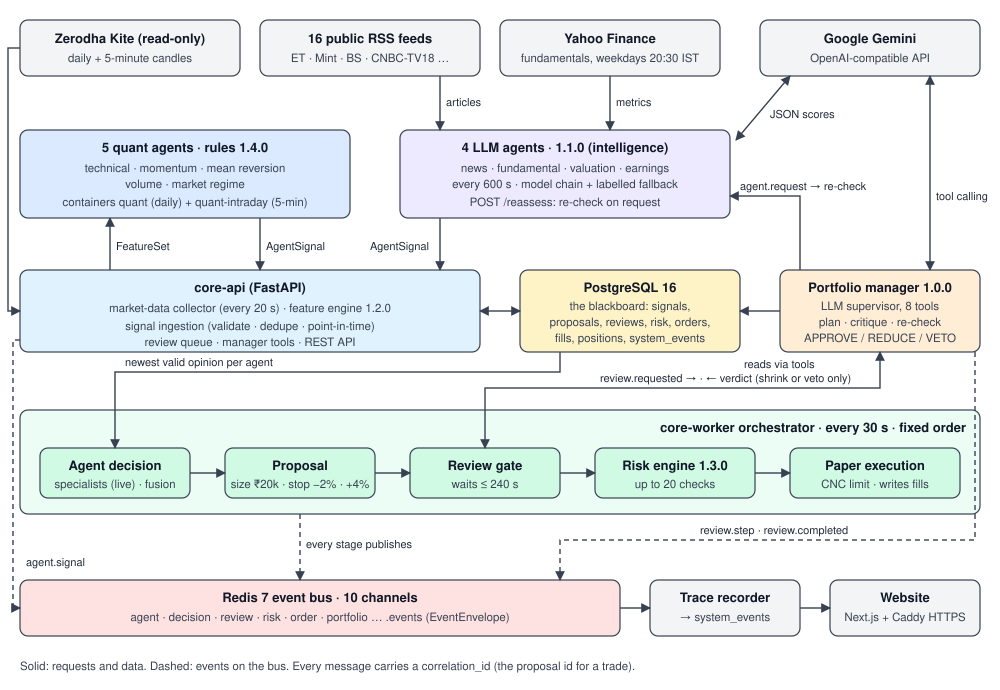

# Design document: StockX multi-agent NIFTY 50 paper trader

Live: https://13-238-176-73.sslip.io · Code: https://github.com/Yashmit-k/Multi-Agent-Trading-Bot · Real trace of one trade: [`agent-trace/20261021-jswsteel-trade.md`](agent-trace/20261021-jswsteel-trade.md)

## (a) Architecture: every agent and how they communicate

Every arrow uses one of these channels:

| From → to | Mechanism | Message |
|---|---|---|
| Kite → collector | HTTPS, `kiteconnect` historical-data API (read-only; no order endpoint is ever called) | Completed daily and 5-minute candles for the 50 stocks, plus NIFTY 50 and India VIX |
| Quant agents → Core | `GET /api/v1/features/{symbol}` (timeframe `1d` or `5m`) | `FeatureSet` built only from bars with `end ≤ as_of` |
| RSS → News agent | HTTPS poll; `defusedxml`; 1 MB and 200-item caps per feed | `NewsArticle`, mapped to NIFTY symbols by company-name aliases |
| Intelligence agents ↔ Gemini | OpenAI-compatible chat completions; JSON answer validated against a closed list of reason codes | sentiment, impact, confidence, event type, reason codes |
| Every specialist → Core | `POST /api/v1/internal/signals` with the internal token | `AgentSignal` |
| Ingestion → bus | Redis channel `agent.events` | `agent.signal` |
| Review gate → manager | review queue row in Postgres + `review.events` | `ReviewRequest` (`review.requested`) |
| Manager ↔ Core tools | `GET /api/v1/internal/tools/{opinions,features,market,portfolio,track_record}` | read-only views of the blackboard |
| Manager → Core | `POST /api/v1/internal/reviews/{id}/steps` and `/verdict` | `ReviewStep` (`review.step`), `ProposalReview` (`review.completed`) |
| Manager → intelligence agent | `agent.request` on `agent.events`, delivered by `POST /reassess` | `AgentRequest`. The reply is a new `AgentSignal` tagged with the `request_id` |
| Orchestrator stages → bus | `decision.events`, `risk.events`, `order.events`, `portfolio.events` | `TradeProposal`, `RiskDecision`, `Order`, `Execution`, `Position` |
| Bus → trace recorder | Redis `SUBSCRIBE` to all 10 named channels | one `system_events` row per `event_id` (a replay is stored once) |
| Browser → Core | Next.js server-side proxy `/api/v1/*`; the token is never sent to the browser | read-only GETs. Writes only for a signed-in operator, plus rate-limited backtest previews |

**Shared contracts.** One schema package, `packages/contracts` (version 1.1.0), defines every message, event type and channel, and every service imports it. Every message travels in an `EventEnvelope` with an `event_id`, `event_type`, `timestamp`, `source`, `correlation_id` and `payload`. For a trade, the `correlation_id` is the proposal id. One chain therefore links proposal → review steps → agent re-check → verdict → risk decision → order → fill → position.

## (b) Agents: roles and responsibilities

| Agent | Kind (version) | Input | Responsibility |
|---|---|---|---|
| Technical | rules (1.4.0) | EMA 12/26, SMA 10/20, close vs SMA20 and VWAP, MACD (all as gaps in ATR units), RSI 14 | Trend and overbought/oversold view. Six weighted votes; a gap smaller than a dead band abstains. |
| Momentum | rules (1.4.0) | 10-bar return in noise units (`roc_10_z`), ADX, return vs NIFTY | Swing: follows the move. Intraday: fades it, because the tuning study found 10-bar moves reverse within the hour. |
| Mean reversion | rules (1.4.0) | close vs Bollinger bands, ADX | Fades closes outside the bands. Swing: only when ADX < 20 (weak trend). |
| Volume | rules (1.4.0) | volume vs its mean, relative volume, price–volume correlation | Participation behind the move (swing); fades heavy-volume moves (intraday). |
| Market regime | rules (1.4.0) | NIFTY 50 day return and EMA 12/26 trend, India VIX change, volatility percentile | Labels the market (trending or ranging, risk-on or risk-off). It is a **filter**, not a vote: weight 0. |
| News | **LLM** (1.1.0) | live RSS articles from the last 72 h (at most 12), boilerplate price pages removed | Score = LLM sentiment × impact. Confidence is capped by article count and freshness (maximum 0.55). |
| Fundamental | **LLM** (1.1.0) | Yahoo growth, ROE and debt, ranked against the other 49 stocks | Score computed by code from the ranks. The LLM explains it and adds confidence (maximum 0.50). |
| Valuation | **LLM** (1.1.0) | price ÷ trailing EPS vs the sector-peer median P/E | Score computed by code (cheaper than peers is positive). The LLM interprets it (confidence maximum 0.50). |
| Earnings | **LLM** (1.1.0) | results articles from the last 7 days | Score = LLM sentiment × impact on the results coverage (confidence maximum 0.55). |
| **Portfolio manager** | **LLM + tools** (1.0.0) | a proposed BUY, plus whatever its tools return | Plans, gathers evidence, names conflicts, asks agents to re-check, then approves, shrinks or vetoes. |
| ML | model, **not loaded** | research features | Off: no model passed its pre-registered gate. |
| Signal ingestion | code | `AgentSignal` | Rejects non-NSE, unknown, future-dated or expired signals; stores a `signal_id` once. |
| Signal fusion | code | newest valid opinion per agent | Confidence-weighted average with per-agent reliability weights (see (c)). |
| Decision engine | code | fused signal (fusion mode) or the specialists' verdicts (specialists mode) + the bar's close | Fusion mode: `TradeProposal` when \|signal\| ≥ 0.2 and confidence ≥ 0.3; agent BUYs also need ≥ 0.35 / ≥ 0.4. Specialists mode: see below. Stop −2%, target +4%. |
| Review gate | code | proposal + manager verdict | Waits up to 240 s. REDUCE scales the quantity; no verdict is recorded as UNAVAILABLE. |
| Risk engine | code (1.3.0) | proposal, paper book, market, supporting opinions, verdict | 6 order checks always. On a BUY: 5 portfolio and 7 trade checks, the manager's verdict, and the market regime for intraday buys (table below). |
| Strategy (Strategy Lab) | code, optional | a user-built rule algorithm applied to paper | Per the `strategy_mode` setting: **replace** the agents' entries, trade **alongside** them, or trade only when the **agents agree** (fused view not bearish, then a manager review). |
| Paper execution | code | approved proposal | CNC limit order at the last daily close + 25 bp, filled on a later 5-minute bar in the 09:20–15:15 IST entry window, Zerodha charges, kill switch. |
| Trace recorder | code | every bus | Append-only record of every handoff. |

**Risk checks** (each limit is a bounded user Setting):

| Group | Checks (default limit) |
|---|---|
| Order (always) | `mode_is_paper` · `universe_member` · `sufficient_cash` · `notional_cap` (₹20,000; BUYs only) · `no_short` · `stop_and_target_side` |
| Portfolio (BUY) | `max_open_positions` (10) · `sector_concentration` (2 per sector) · `exposure_cap` (30% of starting cash) · `per_stock_cap` (₹40,000) · `daily_entry_cap` (6) |
| Trade (BUY) | `daily_loss_limit` (2%) · `drawdown_limit` (10%) · `risk_per_trade` (1% of starting cash lost at the stop) · `reward_to_risk` (≥ 1× by default; 0.5× in the deployment) · `price_drift` (3% from the signal close) · `stop_out_cooldown` (24 h) · `evidence_quality` (no buy that rests only on fallback heuristics) |
| Agents (BUY) | `portfolio_manager` (fails on VETO) · `market_regime` (intraday buys only: NIFTY downtrend *and* VIX rising) |

**Two decision modes** (Settings → "How agent buys are decided"; the deployment uses **specialists**):
- **Fusion:** one confidence-weighted average of the agents (formula in (c)).
- **Specialists:** every agent has one job in a swing BUY, checked in this order (`core_decision/specialists.py`):

| Step | Agent | Rule |
|---|---|---|
| Trigger | Technical, Momentum | a candidate when either scores ≥ +0.30 with confidence ≥ 0.40 |
| Confirm | Volume | blocks at ≤ −0.30 (heavy selling) |
| Not overstretched | Mean reversion | blocks at ≤ −0.50 (closed above the upper band) |
| Event check | News, Earnings | blocks at ≤ −0.30 with confidence ≥ 0.30 |
| Quality check | Fundamental + Valuation | blocks only when both are ≤ −0.50 |
| Market | Regime | NIFTY downtrend with India VIX rising halves the size; it never blocks |
| Review | Portfolio manager | approve, shrink or veto (unchanged) |
| Final say | Risk engine | all 20 checks (unchanged) |

  - Every agent's verdict is stored with the proposal (`metadata.specialists`).
  - LLM opinions that came from the keyword fallback are ignored, so they can neither block nor trigger.
  - Only rule agents trigger, so trading continues when the LLM quota is used up.
  - Exits of held stocks and intraday decisions still use fusion.
  - The thresholds are design choices, not a validated edge.

**Fusion weights now.** They are refreshed hourly from the live scorecard and stored in `user_settings.agent_weights`.
- Swing: News 0.5 ("unproven", because its graded record is still short); every other agent 0.
- Intraday: Technical 1.5 (proven better than a coin flip), Momentum 0.575 and Volume 0.125 (backtest priors), Mean reversion 0 (proven worse than a coin flip). They are not used: the live worker is swing-only (`swing_only` setting), and intraday is future scope.

### Which parts are agentic

| Part | Plans | Reasons with an LLM | Uses tools | Memory | Adapts / replans | Talks to other agents |
|---|---|---|---|---|---|---|
| **Portfolio manager** | yes: writes a plan, then picks tools by what it finds | yes | 8 tools + `submit_verdict` | its past reviews and how the price moved since (`get_track_record`) | yes: retries, switches model, turn budget | asks News, Fundamental, Valuation or Earnings to re-check |
| News, Fundamental, Valuation, Earnings | — | yes | data providers | on-disk answer cache keyed by content | fall back across models; if none answers, report no opinion (`llm_unavailable`) | answer re-check requests |
| Quant agents | — | no: deterministic rules | feature engine | — | — | publish opinions |
| Fusion, decision, risk, execution | — | no: code | — | — | — | — |

The split is deliberate: *agents give opinions; code makes the decisions.* An LLM is good at weighing conflicting, unstructured evidence, and bad at being trusted with money. So the manager can only shrink or block a trade. It can never create one, enlarge one, or skip the risk engine.

### How the agents coordinate: the real trace of 21 Oct 2026 ([JSWSTEEL](agent-trace/20261021-jswsteel-trade.md))

1. **Blackboard.** The News agent's Gemini opinion (+0.56, confidence 0.55, from 10 articles) was stored and published as `agent.signal`.
2. **Orchestrator.** Fusion and the decision engine proposed BUY 16 JSWSTEEL at ₹1,231.00 (stop ₹1,206.38, target ₹1,280.24). The review gate queued it (`review.requested`).
3. **Planning and tools.** The manager wrote a plan and called `get_agent_opinions`, `get_market_context` (NIFTY −1.11% on the day, risk-off) and `get_price_features`.
4. **Code critiques the LLM.** Its first draft (REDUCE ×0.5) was sent back. The only voting agent's current opinion rested on a fallback heuristic, so it had to ask for a re-check first.
5. **Recovery from its own error.** It called a non-existent tool (`agent_to_recheck`), received `error: unknown tool`, and corrected itself to `ask_agent_to_recheck`.
6. **Agent-to-agent request.** An `agent.request` went to the News agent. The agent pulled all 16 feeds again and replied with a new signal. Gemini's quota was used up at that moment, so the reply was correctly labelled `fixture` and `fallback: true`.
7. **Verdict.** REDUCE ×0.5, listing both conflicts. The risk engine ran 19 checks, all of which passed, and approved 8 shares instead of 16.
8. **Execution.** A limit order at ₹1,234.05 (close + 25 bp, rounded down to the tick) filled at 12:05 IST, with ₹11.85 of Zerodha charges.

**Failure handling:**
- a failed tool returns `{"error": …}` to the model, which picks another route;
- an LLM 429, 5xx or timeout is retried once;
- a failed model switches to the backup;
- if no model answers, a labelled `rule_fallback` review is used;
- an intelligence agent with no model answer reports no opinion (score 0, `llm_unavailable`); it cannot block or support a trade;
- if there is no verdict within 240 s, `UNAVAILABLE` is recorded and the risk engine decides alone.

The system slows down; it does not crash.

## (c) Orchestration pattern

**Blackboard + orchestrator-worker, with an LLM supervisor that critiques the orchestrator's output.** The supervisor can ask workers to redo their part.

- **Blackboard (independent specialists).** The 9 specialists run in their own containers on their own schedules:
  - quant: daily bars and 5-minute bars, a pass every 300 s;
  - intelligence: a pass every 600 s.

  They never call each other. Each writes opinions to the shared signal store in Postgres. One agent can fail or lag without affecting the others.
- **Orchestrator-worker (deterministic pipeline).** `core-worker` runs settle → exits → fusion → decision → review gate → risk → execution every 30 s during the cash session. The order is fixed, so no opinion can skip risk.
- **Supervisor and critic (the portfolio manager).** The pipeline hands each BUY to the manager and waits.
  - The manager decides what to look at, can disagree with the fused signal, and can ask a specialist to look again.
  - Its verdict changes what the pipeline does next: approve, shrink or block.
  - Code critiques the manager in turn: a draft that ignores a disagreeing agent or an unverified fallback opinion goes back for revision. Each side checks the other.
- **Fusion formula** for one stock and horizon, over the newest valid signal from each agent with weight wᵢ > 0:
  - fused signal = Σ wᵢ·sᵢ·cᵢ / Σ wᵢ·cᵢ, clipped to [−1, 1];
  - fused confidence = Σ wᵢ·cᵢ / Σ wᵢ.

  An agent with no opinion (cᵢ = 0) neither votes nor dilutes the signal, but it still lowers the confidence.
- **Event bus.** Every stage and every reasoning step is a typed `EventEnvelope` on a per-domain Redis channel. The recorder and the website read the bus, so observability needs no pipeline changes.
- **Idempotency.** Signal, proposal, review, risk, order and execution ids are SHA-256 hashes of their inputs, backed by unique constraints. A replayed cycle or a duplicate message changes nothing, and a second verdict for the same review is refused (HTTP 409).

**Why this pattern rather than a free-form agent swarm.** Money decisions need a fixed, auditable path:
- a blackboard keeps the specialists independent and replaceable;
- a supervisor that can only veto or shrink adds judgement where it is useful (weighing conflicting evidence) without adding a new way to lose money.

## (d) Technology choices

| Choice | Why |
|---|---|
| **Custom agent loop** (no LangGraph or CrewAI) | The manager's loop is about 250 lines over OpenAI-compatible tool calling. A framework would add a dependency and hide the steps we need on the bus. Our loop posts every plan, tool call, result, critique and replan as a typed event. It preserves Gemini 3's thought signatures between turns, and lets plain code critique each draft verdict. |
| **Google Gemini, model chosen per agent** | News: `gemini-3.1-flash-lite` (500 free requests a day, kept for the only voting swing agent). Fundamental, valuation and earnings: `gemini-3.5-flash-lite`, a separate quota. Backups for both: `gemini-3.6-flash`, then `gemini-3-flash-preview`; if none answers, the agent reports no opinion. Re-checks: `gemini-3-flash-preview`, a second independent look. Manager: `gemini-3.5-flash-lite`, backup `gemini-3.5-flash`. Gemini reports whether a 429 is a daily or per-minute limit; the model is paused for exactly its `retryDelay`. Answers are cached on disk by content hash, so unchanged news costs no quota. Any OpenAI-compatible provider works. |
| **Python 3.12, FastAPI, Pydantic v2** | One language for research, agents and execution; typed request and response validation from the shared contracts |
| **`packages/contracts`** | One validated schema per message, exported as JSON Schema; the TypeScript types are generated from it |
| **PostgreSQL 16 + SQLAlchemy + Alembic** | Transactions for cash reservations, orders, the daily entry cap and the review queue (`FOR UPDATE SKIP LOCKED`); 15 reviewed migrations |
| **Redis 7 pub/sub** | A lightweight bus between independent containers; one channel per domain, never one per agent |
| **Zerodha Kite Connect** | The official NSE market-data API. A daily OAuth login is needed (the token expires at 06:00 IST). Order placement is never called. |
| **Next.js 15 + React 19 + SWR + Tailwind** | A server-side proxy keeps the API token off the browser. SWR polls the trace and reviews. An HMAC-signed operator cookie (12 h, `HttpOnly`, `SameSite=Strict`) guards writes. |
| **Docker Compose + Caddy on AWS EC2** | The same 11-container stack locally and in the cloud. Caddy provides automatic HTTPS. Only ports 80 and 443 are public; Core listens on 127.0.0.1. |
| **pytest + vitest + GitHub Actions** | 458 core, 30 contracts, 119 intelligence, 204 quant and 75 frontend tests (886 in total), all passing on `main`. They include scripted-LLM tests of the manager's critique, failover and fallback. |

## Safety properties

- `live_enabled` is hard-coded `false`. No code path calls a broker order endpoint. The risk engine accepts `PAPER` only.
- A manager verdict can only be APPROVE (×1), REDUCE (×0.1–0.9), VETO (×0) or UNAVAILABLE. A reduced quantity is passed to the order as a cap.
- Tool results, headlines and agent reasons go to the LLM as untrusted data, and the system prompt says so. LLM output cannot contain an order: only a score and a closed list of reason codes are accepted.
- The public proxy refuses writes. Settings, manual orders, strategies, the kill switch and questions to the manager need the operator sign-in (5 failed attempts lock that address out). Paper start and stop are not reachable from the browser at all.
- The worker sits behind a Compose profile. The manager review, agent entries and intraday entries can each be switched off in Settings.
