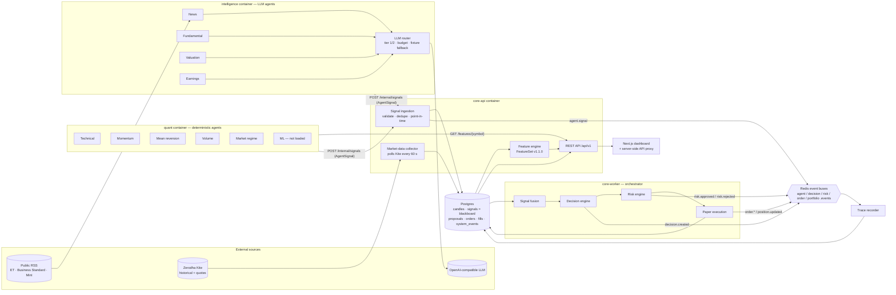

# Design document

## (a) Architecture: every agent and how they communicate

Communication channels:

| From → to | Mechanism | Message |
|---|---|---|
| Kite → collector | HTTPS (kiteconnect) | 5-minute and daily candles |
| Quant agents → Core | HTTP `GET /api/v1/features/{symbol}` | `FeatureSet` (point-in-time; only bars with `end ≤ as_of`) |
| RSS → News agent | HTTPS poll every 5 min, `defusedxml`, size/item caps | `NewsArticle` mapped to NIFTY symbols |
| Intelligence agents → LLM | OpenAI-compatible chat completions | structured JSON assessment, validated before use |
| Every agent → Core | HTTP `POST /api/v1/internal/signals` (internal token, `X-Trading-Mode`) | `AgentSignal` |
| Ingestion → bus | Redis pub/sub `agent.events` | `EventEnvelope{event_type: agent.signal}` |
| Orchestrator stages → bus | Redis `decision.events`, `risk.events`, `order.events`, `portfolio.events` | `TradeProposal`, `RiskDecision`, `Order`, `Execution`, `Position` |
| Bus → trace recorder | Redis subscribe to all 9 channels | stored once per `event_id` in `system_events` |
| Dashboard → Core | Next.js server proxy (adds token server-side, refuses writes) | read-only REST |

One schema package, `packages/contracts`, defines every message. All services import it, and none redefine it. Every envelope has a `correlation_id`: the signal id for `agent.signal`, and the proposal id for everything downstream. A proposal also lists its `supporting_signal_ids`. With both, one trade can be traced back to the exact agent opinions behind it.

## (b) Agents: roles and responsibilities

| Agent | Kind | Input | Output / responsibility |
|---|---|---|---|
| Technical | Deterministic | FeatureSet: RSI, MACD, EMA, Bollinger %B, VWAP distance | Trend/overbought vote |
| Momentum | Deterministic | return_1, momentum_10, MACD, ROC-10, ADX | Short-term momentum vote |
| Mean reversion | Deterministic | z-score, distance from mean, half-life | Flags overextended moves |
| Volume | Deterministic | relative volume, acceleration, price-volume correlation | Unusual activity / liquidity |
| Market regime | Deterministic | volatility percentile, NIFTY/INDIA VIX when supplied | Trending / volatile / risk-off context |
| ML | Model (not loaded) | research features | Probability-style score; off until a model passes validation |
| News | **LLM** | live RSS headlines for the symbol, point-in-time | Sentiment × impact, event type, headlines in metadata |
| Fundamental | **LLM** | growth, margins, debt, ROE (fixture data) | Company health; **excluded from fusion** |
| Valuation | **LLM** | price vs history/peers (fixture data) | Cheap/expensive; **excluded from fusion** |
| Earnings | **LLM** | results vs expectations (fixture data) | Earnings surprise; **excluded from fusion** |
| Signal ingestion | Code | `AgentSignal` | Rejects non-NSE, unknown symbol, future-dated, duplicate, or wrong-mode signals; stores them; publishes `agent.signal` |
| Signal fusion | Code | Newest valid signal per agent and horizon | Weighted average, clipped to [-1, 1]; per-agent weights, with weight 0 for agents that have no live source |
| Decision engine | Code | Fused aggregate + latest candle | `TradeProposal` when \|signal\| ≥ 0.2 and confidence ≥ 0.3; 2 % stop, 4 % target; deterministic SHA-256 id |
| Risk engine | Code | Proposal, cash, holdings, universe | Six checks: paper mode, universe member, cash, ₹20,000 notional cap, no short, stop/target side |
| Paper execution | Code | Approved proposal | CNC limit order, fill at the next bar, Zerodha charges, at most 6 entries per IST day, 09:20–10:30 IST entry window, kill switch |
| Trace recorder | Code | Every Redis bus | Append-only audit of agent handoffs |

### Which parts are agentic

Only the four **Intelligence agents** are agentic in the LLM sense. Each one interprets unstructured text through a language model and returns a structured opinion. The five **Quant agents** are deterministic functions of market features. **Fusion, Decision, Risk, and Execution** are ordinary code.

This split is deliberate. LLMs are good at reading news and filings and bad at being trusted with money. So the rule is that *agents give opinions and code makes the decisions*:
- No LLM output can place, size, or approve an order.
- LLM responses are schema-validated.
- A failed or over-budget call falls back to a deterministic heuristic, and the signal records `fallback: true` / `model: fixture`. The dashboard shows that label.

## (c) Orchestration pattern

**Blackboard + orchestrator-worker, joined by an event bus.**

- **Blackboard (peer producers).** The quant and intelligence agents run in their own containers, on their own schedules (quant every 5 min, intelligence every 10 min). They don't know about each other. Each one writes opinions to a shared store: the `agent_signals` table, reached through the ingestion API. That decoupling lets an agent fail, lag, or be added without touching the others. Fusion simply uses the newest valid opinion of each agent.
- **Orchestrator-worker (decision pipeline).** `core-worker` is the orchestrator. On each 30-second tick during the cash session it runs:
  1. settle open orders;
  2. monitor stops and targets;
  3. check the kill switch;
  4. check the entry gate: broker authenticated, entry window, fresh data for all 50 names, daily cap;
  5. for each symbol and horizon: fuse → propose → risk-assess → queue the order.

  Each stage is an isolated package with a pure interface. The order is fixed, so a bad opinion can never skip risk.
- **Event bus.** Every stage publishes a typed `EventEnvelope` to a domain channel on Redis. Channels are per domain, never per agent. The trace recorder and the dashboard consume the bus, so observability needs no changes to the pipeline.
- **Idempotency.** Proposal, risk, order, and execution ids are SHA-256 digests of their inputs, backed by unique constraints. A replayed cycle or a duplicate message changes nothing.

## (d) Technology choices

| Choice | Why |
|---|---|
| **Python 3.12** for all backend services | Same language for research, agents, and execution; mature finance and data libraries |
| **Pydantic v2** contracts package | One validated schema for every message, published as JSON Schema/OpenAPI so the TypeScript frontend generates matching types |
| **FastAPI** | Typed request/response validation from the same models, async background collector, automatic OpenAPI |
| **PostgreSQL 16 + SQLAlchemy + Alembic** | Transactional integrity for cash, orders, and the daily entry cap (row locks); reviewed migrations |
| **Redis 7 pub/sub** | Lightweight event bus between independent containers; one channel per domain |
| **Zerodha Kite Connect** | Official NSE market-data API; order placement is never called |
| **OpenAI-compatible LLM router** | Provider-agnostic (Groq, OpenRouter, OpenAI, local); tiered models, daily budget, deterministic fallback for reproducibility |
| **defusedxml + httpx** for RSS | Safe XML parsing, size/item caps, retries |
| **Next.js 15 + React 19 + SWR + Tailwind** | Server components read Core directly. A server-side proxy keeps the API token off the browser. SWR polls the live trace. |
| **Docker Compose + Caddy** | Same seven-service stack locally and on one cloud VM. Caddy provides automatic HTTPS. Only ports 80/443 are public. |
| **pytest + vitest + GitHub Actions** | 302 core tests, 85 intelligence tests, 151 quant tests (including no-look-ahead tests for the ML ranker) and 57 frontend tests, run on every push |
| **scikit-learn** | Gradient boosting and ridge for the pre-registered ML ranker. Small, fixed hyperparameters, walk-forward refits with an embargo. |

## Observability

- `GET /api/v1/system/health` checks every component: Kite, collector, Postgres, Redis, quant agents, LLM agents, intelligence service, trace recorder, orchestrator, and paper session. The dashboard's pipeline strip and the **System** page show it.
- `GET /api/v1/decisions/chain` joins each proposal to its risk decision and order. The **Risk** page lists recent decisions with every failed check named.
- `GET /api/v1/trace` serves the recorded bus messages. The **Agent trace** page and `scripts/export_agent_trace.py` use it.

## Safety properties

- `live_enabled` is hard-coded `false` in every API response, in the collector, and in the worker guard. No code path calls a broker order endpoint.
- Risk accepts `PAPER` only. `LIVE`, `SHADOW`, and `BACKTEST` are rejected inside `assess()`.
- The public dashboard proxy refuses every POST by default, so visitors cannot start trading or change risk state.
- The worker sits behind a Compose profile and never starts with a plain `docker compose up`.
